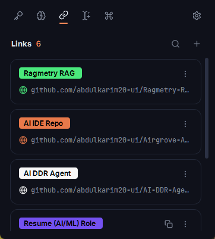
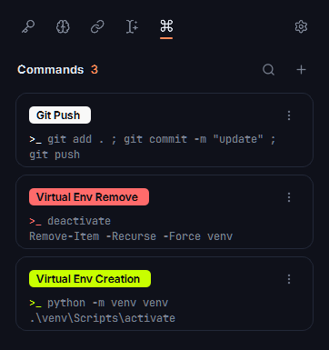
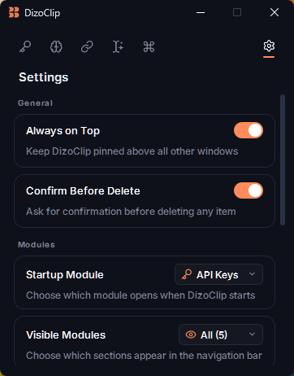
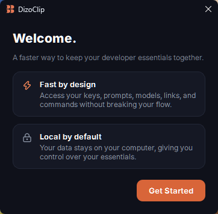
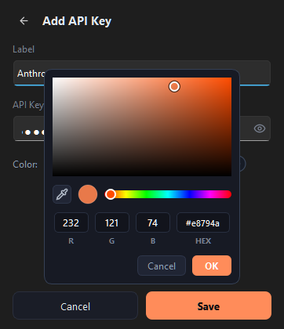

<div align="center">

  

  # DizoClip

  **The Lightweight, Privacy-First Developer Clipboard Manager**
  
  *Keep your API keys, prompts, code snippets, and terminal commands instantly accessible on your desktop.*

  [](https://python.org)
  [](https://wiki.qt.io/Qt_for_Python)
  [](https://microsoft.com/windows)
  [](LICENSE)
  [](docs/security.md)

  [🚀 Quick Start](#-quick-start) • [📖 Features](#-features) • [🎨 Screenshots](#-screenshots) • [🛡️ Security](#-security) • [📝 License](#-license)

</div>

---

## 🎯 The Problem

Developers constantly suffer from **context switching**:

- 🔑 Hunting through scattered `.env` files and cloud consoles for API keys
- 📝 Digging through old chat histories to find that perfect system prompt
- 🔄 Re-googling boilerplates and SDK examples every time you start a new project
- 💻 Re-typing complex terminal commands from browser history
- ⏱️ Losing 5-10 minutes per day just searching for developer essentials

**DizoClip solves this.** Keep everything you need just one click away—right on your desktop.

---

## ✨ Why DizoClip?

| Challenge | DizoClip Solution |
| :--- | :--- |
| **Scattered API Keys** | Encrypted local storage with one-click copy and secure reveal toggle |
| **Lost Prompts** | Dedicated prompts library with multiline preview and instant access |
| **Language Switching** | Multi-language code snippets (Python, Node.js, Shell, LangChain) in every card |
| **Bookmark Hell** | Consolidated quick links hub with direct browser launch |
| **Forgotten Commands** | Terminal command library with syntax highlighting and instant copy |
| **Privacy Concerns** | **100% Offline & Local**: No cloud sync, no accounts, no telemetry. Your data never leaves your device. |

---

## 🚀 Quick Start

### Prerequisites
- **Windows 10** or **Windows 11**
- **Python 3.10+** ([download](https://www.python.org/downloads/))

### Installation

```bash
# Clone the repository
git clone https://github.com/abdulkarim20-ui/DizoClip.git
cd DizoClip

# Create virtual environment
python -m venv .venv
.\.venv\Scripts\activate

# Install dependencies
pip install -r requirements.txt

# Run DizoClip
python main.py
```

> **First Launch?** DizoClip will guide you through a quick onboarding tour. Don't skip it!

---

## 📖 Features

### 🔐 1. Encrypted API Keys & Secrets Manager

Store, organize, and instantly access your API keys, tokens, and environment variables—all protected with Windows DPAPI encryption.

**What it does:**
- ✅ Encrypt secrets at rest using Windows DPAPI (bound to your user account)
- ✅ Mask sensitive data with crisp asterisks
- ✅ Assign color-coded categories (Production, Staging, Personal, etc.)
- ✅ One-click copy with visual confirmation
- ✅ Reveal/hide toggle for secure viewing

**Why it helps:**
- Eliminates the need to hunt through multiple `.env` files
- Keeps sensitive data protected on your local machine
- Color-coded organization for quick identification
- No cloud exposure, no accidental pastes in chat

<div align="center">
  
</div>

---

### 📚 2. AI Prompts Library

Build a personal repository of system prompts, instructions, and templates for ChatGPT, Claude, Gemini, and other LLM agents.

**What it does:**
- ✅ Store multiline prompts with full formatting preserved
- ✅ Quick preview cards with automatic height balancing
- ✅ One-click copy to clipboard for direct pasting
- ✅ Color-coded categorization
- ✅ Full-text search across all prompts

**Why it helps:**
- Never dig through old chat histories for that perfect system prompt again
- Test and refine prompts without re-typing them every time
- Build a personal knowledge base of effective AI instructions
- Instantly apply tested prompts to new conversations

<div align="center">
  
</div>

---

### 💻 3. AI Models & Code Snippets

Reference multi-language code examples for initializing and using your favorite AI model APIs.

**What it does:**
- ✅ Pre-built snippets for popular models (OpenAI, Anthropic, Google, etc.)
- ✅ **Multi-language switcher**: Python, Node.js, Shell (cURL), LangChain
- ✅ Syntax-highlighted code display
- ✅ One-click copy with language-aware formatting
- ✅ Color-coded categorization
- ✅ Full-text search across models and snippets
- ✅ Quick reference for authentication and configuration

**Why it helps:**
- Stop re-googling "how to initialize Claude in Python" every time
- Language-agnostic reference—find examples in any language instantly
- Copy boilerplate code directly into your project
- Consistent, tested initialization patterns

<div align="center">
  
</div>

---

### 🔗 4. Quick Links Hub

Centralize your most-used dashboards, cloud consoles, documentation, and environment URLs in one accessible place.

**What it does:**
- ✅ Store frequently-accessed URLs (AWS Console, GitHub, Docs, etc.)
- ✅ One-click launch in default browser
- ✅ Quick copy of URLs for terminal use or sharing
- ✅ Color-coded organization by project or service
- ✅ Full-text search across links and titles
- ✅ No browser bookmark hunting required

**Why it helps:**
- Eliminate tab clutter—everything in one place
- Launch environments without searching bookmarks
- Access staging/production URLs instantly
- Share links without manually copying from browser

<div align="center">
  
</div>

---

### 🖥️ 5. Terminal Commands Library

Keep your Docker commands, Git recipes, Kubernetes manifests, and database queries organized and instantly copyable.

**What it does:**
- ✅ Store complex CLI commands with descriptions
- ✅ Monospace font rendering (JetBrains Mono) for clarity
- ✅ One-click copy with checkmark feedback
- ✅ Full-text search across all commands
- ✅ Color-coded by command type (Docker, Git, K8s, etc.)

**Why it helps:**
- Never re-type `git rebase -i HEAD~5` or complex Docker builds again
- Keep Kubernetes manifests and database queries organized
- Copy commands instantly instead of hunting browser history
- Reduce typos and syntax errors in complex CLI operations

<div align="center">
  
</div>

---

### ⚙️ 6. Smart Settings & Customization

Tailor DizoClip to your exact workflow and desktop setup.

**What it does:**
- ✅ **Always on Top**: Keep DizoClip floating above all windows for rapid multitasking
- ✅ **Startup Module Selector**: Choose which module (API Keys, Prompts, Snippets, Links, or Commands) opens immediately on application launch
- ✅ **Module Visibility Toggle**: Hide modules you don't need and show only the tools you use daily
- ✅ **Hold-and-Drag Tab Reordering**: Hold and drag any module tab at the top of the window to arrange them in your preferred sequence
- ✅ **Hold-and-Drag Card Reordering**: Rearrange cards within any module effortlessly by clicking, holding, and dragging a card to its new position with automatic persistent saving
- ✅ **Custom Brand Color Picker**: Pick any custom brand color for your resources with the interactive 2D HSV gradient canvas, hue slider, RGB/Hex inputs, or the precision screen eyedropper pipette tool with real-time dark-theme contrast validation
- ✅ **Delete Safeguard**: Optional confirmation dialog to prevent accidental deletions

**Why it helps:**
- Position DizoClip next to your IDE or terminal without losing focus
- Faster access by opening your most-used module first
- Keep your workspace minimal by showing only active tools
- Arrange cards and tabs by project priority or frequency of use
- Match cards to official brand colors (e.g., Anthropic orange, OpenAI teal, Docker blue, GitHub purple)

<div align="center">
  
</div>

---

## 🎨 Screenshots

### Welcome Onboarding

<div align="center">
  
</div>

First-time launch includes a clean onboarding tour introducing DizoClip's local-first philosophy and core features.

### Custom Color Picker & Brand Colors

<div align="center">
  
</div>

Precision 2D HSV color canvas, rainbow hue slider, RGB/HEX numeric inputs, and screen eyedropper pipette tool with real-time dark-theme contrast validation. Pick any brand color to categorize your API keys, prompts, snippets, links, and commands.

### Add & Edit Forms

<div align="center">
  
</div>

Intuitive forms with interactive toggles, color pickers, and validation for adding new resources.

---

## 🎨 Design System

DizoClip uses a carefully crafted **Midnight Slate** color palette optimized for dark environments and reduced eye strain:

| Element | Color | Purpose |
| :--- | :--- | :--- |
| **Main Background** | `#0f111a` | Deep midnight slate canvas |
| **Card Background** | `#141722` | Elevated surfaces with soft contrast |
| **Accent Color** | `#ff8c5a` | Coral orange for actions and highlights |
| **Primary Text** | `#e2e8f0` | High-contrast readable text |
| **Secondary Text** | `#7a8292` | Subdued labels and metadata |
| **Borders** | `#232838` | Structural separators |

**Typography:**
- **UI Text**: Inter Variable Font (clean, modern)
- **Code Snippets**: JetBrains Mono (monospace, readable)

**Icons:**
- All vector SVGs with runtime color tinting for flexibility

---

## 🛡️ Security & Privacy

### Your Data, Your Control

DizoClip is engineered with security-first principles:

#### 🔐 Windows DPAPI Encryption
```
Secret → Windows DPAPI CryptProtectData → Encrypted at Rest → Local File
```
- Secrets encrypted using Windows DPAPI (`crypt32.dll`)
- Encryption key bound to your Windows user account
- Only you can decrypt data on your machine
- **Zero network calls** - no cloud sync

#### 💾 Atomic Writes & Backups
- All data writes are atomic (written to temp, flushed to disk, then committed)
- Prevents corruption during power loss
- Automatic timestamped backups before modifications
- Crash-safe persistence guaranteed

#### 🚫 Privacy by Default
- ✅ 100% offline operation
- ✅ No internet connectivity required
- ✅ No telemetry or tracking
- ✅ No user accounts or login
- ✅ No data leaves your machine

---

## 💾 Storage & Persistence

DizoClip adapts to your deployment:

| Mode | Location | When |
| :--- | :--- | :--- |
| **Development** | `<project>/User_Data/` | Running from source (`python main.py`) |
| **Portable** | `<exe_dir>/User_Data/` | When `portable.flag` exists next to executable |
| **Installed** | `%APPDATA%\DizoClip\User_Data\` | Standard Windows installation |

All data is stored locally in JSON format with automatic backup management.

---

## 🏗️ Architecture

### Project Structure

```
DizoClip/
├── app/
│   ├── core/              # Core utilities (encryption, storage, fonts)
│   ├── components/        # Reusable UI components
│   ├── sections/          # Feature modules (keys, prompts, etc.)
│   ├── views/             # Main UI layouts
│   ├── window/            # Window management
│   ├── config/            # Configuration and theme
│   └── utils/             # Helper utilities
├── assets/                # Icons, fonts, images
├── docs/                  # Documentation
├── main.py                # Application entry point
├── requirements.txt       # Python dependencies
└── README.md              # This file
```

### Tech Stack

- **Framework**: PySide6 (Qt 6)
- **Language**: Python 3.10+
- **Encryption**: Windows DPAPI
- **UI Theme**: Custom Fusion-based palette
- **Platform**: Windows 10+ only

---

## 🚀 Getting Started

### First Launch

1. **Run DizoClip**: `python main.py`
2. **View Onboarding**: Brief intro to local-first philosophy
3. **Start Adding Content**: Click **+** to add your first key, prompt, or command
4. **Pin to Desktop**: Use "Always on Top" in Settings
5. **Customize**: Arrange modules and toggle visibility as needed

### Basic Workflows

#### Adding an API Key
1. Go to **API Keys** tab
2. Click **+** button
3. Enter key name and secret value
4. Pick a color category
5. Click **Save**
6. One-click copy anytime!

#### Creating a Prompt Template
1. Go to **Prompts** tab
2. Click **+** button
3. Enter name and multiline prompt text
4. Assign color category
5. Click **Save**
6. Copy to clipboard instantly

#### Storing a Terminal Command
1. Go to **Commands** tab
2. Click **+** button
3. Enter command name and full command
4. Click **Save**
5. One-click copy when you need it

---

## 📊 Features at a Glance

| Feature | API Keys | Prompts | Snippets | Links | Commands |
| :--- | :---: | :---: | :---: | :---: | :---: |
| Add/Edit/Delete | ✅ | ✅ | ✅ | ✅ | ✅ |
| Full-Text Search | ✅ | ✅ | ✅ | ✅ | ✅ |
| Color Categories & Custom Picker | ✅ | ✅ | ✅ | ✅ | ✅ |
| Drag-and-Drop Card Reorder | ✅ | ✅ | ✅ | ✅ | ✅ |
| One-Click Instant Copy | ✅ | ✅ | ✅ | ✅ | ✅ |
| Reveal/Hide Secret Toggle | ✅ | ❌ | ❌ | ❌ | ❌ |
| One-Click Browser Launch | ❌ | ❌ | ❌ | ✅ | ❌ |
| Multi-Language Code Switcher | ❌ | ❌ | ✅ | ❌ | ❌ |
| Windows DPAPI Encryption | ✅ | ❌ | ❌ | ❌ | ❌ |

---

## 🧪 Testing

Run the automated test suite:

```bash
pytest
```

Tests cover:
- Data persistence and storage
- Encryption/decryption workflows
- UI component interactions
- Settings and configuration

---

## 🤝 Contributing

We welcome contributions! Feel free to:
- Report bugs and request features via [GitHub Issues](https://github.com/abdulkarim20-ui/DizoClip/issues)
- Submit pull requests to improve functionality
- Share feedback and suggestions

---

## 📖 Documentation

- [Security Deep Dive](docs/security.md) - Encryption and privacy details
- [Architecture Guide](docs/architecture.md) - Internal structure and components
- [Settings Reference](docs/settings.md) - All customization options
- [Troubleshooting](docs/troubleshooting.md) - Common issues and solutions

---

## ⚡ Performance

DizoClip is engineered for speed:

- ⚡ **Instant Launch**: Loads in under 1 second
- 🎯 **Fast Search**: Full-text search across 1000+ items in <100ms
- 💾 **Minimal Memory**: ~50MB RAM during operation
- 🔄 **Smooth Animations**: 60 FPS window transitions
- 🖥️ **Low CPU**: Idle CPU usage <1%

---

## 🗺️ Roadmap

### Upcoming Features (v1.1)

- [ ] Tags system for advanced organization
- [ ] Export/Import functionality for backups
- [ ] Custom hotkey support for quick access
- [ ] Command execution helpers
- [ ] Prompt versioning and history
- [ ] Dark/Light theme toggle

### Future Considerations

- Multi-device sync (encrypted end-to-end)
- Browser extension for direct capture
- Mobile companion app
- Team collaboration features (local network only)

---

## 🆘 Troubleshooting

### DizoClip won't launch
```bash
# Try running with verbose output
python main.py --debug
```

### Data not saving
- Check that `User_Data/` directory has write permissions
- Ensure you have space on disk
- Review backups in `User_Data/Backups/`

### Secrets not decrypting
- Only accessible from the Windows user account that encrypted them
- Switching user accounts requires re-entering secrets

For more help, see [Troubleshooting Guide](docs/troubleshooting.md) or open a [GitHub Issue](https://github.com/abdulkarim20-ui/DizoClip/issues).

---

## 📜 License

This project is licensed under the **MIT License** — see the [LICENSE](LICENSE) file for full details.

You are free to:
- ✅ Use DizoClip personally and commercially
- ✅ Modify and distribute the code
- ✅ Create derivative works

---

## 👨‍💻 About the Creator

**DizoClip** was created with ❤️ by **AbdulKarim** to solve real developer pain points.

- 🐙 **GitHub**: [@abdulkarim20-ui](https://github.com/abdulkarim20-ui)
- 💼 **LinkedIn**: [AbdulKarim](https://www.linkedin.com/in/abdulkarim27)

### Support DizoClip

If you find DizoClip helpful:
- ⭐ Star this repository
- 🐛 Report bugs and suggest features
- 📢 Share with other developers
- 💬 Provide feedback and ideas

---

## 🙏 Acknowledgments & Attributions

- **App Logo**: "Letter d" icon designed by [edt.im](https://www.flaticon.com/authors/edtim) from [Flaticon.com](https://www.flaticon.com/) (Licensed under Free for commercial use with attribution).
- **GUI Framework**: Built with **PySide6 (Qt 6)** - Python bindings for Qt
- **Typography**: **Inter** (by Rasmus Andersson) and **JetBrains Mono** (by JetBrains)
- **UI Icons**: Lucide icon collection
- Inspired by developer productivity and privacy-first workflow optimization

---

<div align="center">

**Made with ❤️ for developers who value time and security**

[Back to Top](#dizoclip)

</div>