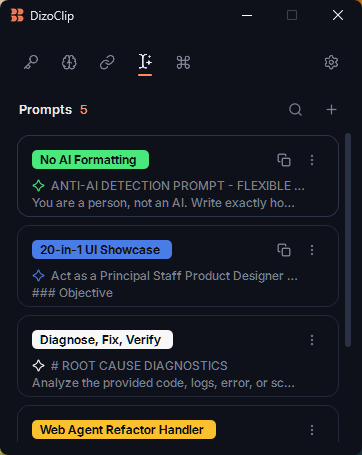
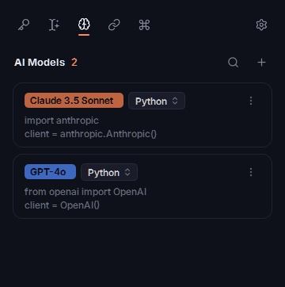

<div align="center">

  

  # DizoClip

  **The Lightweight, Privacy-First Developer Companion**  
  *Instant 1-click access to API keys, AI prompts, model snippets, quick links, and terminal commands.*

  <br/>

  [](https://python.org)
  [](https://wiki.qt.io/Qt_for_Python)
  [](https://microsoft.com/windows)
  [](#-security--dpapi-encryption)
  [](LICENSE)

</div>

---

## 📌 Table of Contents
- [The Problem & The Vision](#-the-problem--the-vision)
- [Why You Need DizoClip](#-why-you-need-dizoclip)
- [Onboarding Experience](#-onboarding-experience)
- [Feature Breakdown & Module Walkthrough](#-feature-breakdown--module-walkthrough)
  - [1. API Keys & Secrets Manager](#1-api-keys--secrets-manager)
  - [2. Prompts Library](#2-prompts-library)
  - [3. AI Models & Snippets](#3-ai-models--snippets)
  - [4. Quick Links Hub](#4-quick-links-hub)
  - [5. Terminal Commands Library](#5-terminal-commands-library)
  - [6. Creation & Edit Workflows](#6-creation--edit-workflows)
  - [7. Settings & Customization](#7-settings--customization)
- [Design Aesthetics & Color System](#-design-aesthetics--color-system)
- [Architecture & Tech Stack](#-architecture--tech-stack)
- [Security & DPAPI Encryption](#-security--dpapi-encryption)
- [Runtime Modes & Persistence](#-runtime-modes--persistence)
- [Getting Started](#-getting-started)
- [License & Creator](#-license--creator)

---

## 💡 The Problem & The Vision

As developers, we suffer from constant **context switching**:
* Searching through dozens of messy `.env` files or cloud consoles just to grab an API key.
* Hunting down that perfect ChatGPT or Claude system prompt buried in old browser chats.
* Re-googling boilerplates for OpenAI or Anthropic client initializations across Python, Node.js, and cURL.
* Re-typing long, complex Docker, Git, or Kubernetes terminal commands from browser history.

**DizoClip** was engineered to solve this context switching. Designed as a floating, ultra-responsive desktop widget built in **PySide6 (Qt 6)**, DizoClip lives right on your desktop—pin it **Always-on-Top** next to your IDE or terminal for instantaneous 1-click clipboard actions.

---

## ✨ Why You Need DizoClip

| Everyday Pain Point | How DizoClip Solves It |
| :--- | :--- |
| **Scattered API Keys** in `.env` files and browser consoles | Encrypted locally via Windows DPAPI with quick copy and reveal toggles. |
| **Lost AI Prompts** in disparate chat histories | Dedicated prompts library with multiline preview and single-click copy. |
| **Language Snippet Lookup** for AI model SDKs | Multi-language switcher (Python, Node.js, Shell, LangChain) built into each model card. |
| **Buried Bookmarks** across multiple browsers | Consolidated Quick Links hub with direct default browser launch buttons. |
| **Forgotten CLI Commands** (Docker, Git rebase, K8s) | Terminal command library with monospace syntax display and instant copy feedback. |
| **Privacy & Cloud Leaks** | **100% Offline & Local**: Your secrets never leave your device. No telemetry, no accounts. |

---

## 🚀 Onboarding Experience

When launching DizoClip for the first time, you are greeted with a clean, focused onboarding modal introducing the local-first philosophy and high-performance workflow:

<div align="center">
  
</div>

* **Fast by design**: Kept lightweight so you can access developer essentials without interrupting your development flow.
* **Local by default**: Data remains stored strictly on your local PC.
* **Native Integration**: Seamless dark title bar and Windows taskbar integration matching the app palette.

---

## 🧩 Feature Breakdown & Module Walkthrough

### 1. API Keys & Secrets Manager
Safely store API keys, tokens, environment variables, and client secrets.

<div align="center">
  
</div>

* **Protected Storage**: Keys are encrypted at rest using the Windows DPAPI cryptographic subsystem.
* **Clean Asterisk Masking**: Secrets are masked with crisp, centered asterisks (`*`) rather than oversized bullet points.
* **Visual Color Chips**: Assign custom colored category chips to easily distinguish production, staging, or personal keys.
* **Instant Copy with State Feedback**: Click the copy button to transfer the raw key to clipboard with animated visual checkmark confirmation.

---

### 2. Prompts Library
A specialized repository for storing and refining reusable prompts for ChatGPT, Claude, Gemini, Midjourney, and custom LLM agents.

<div align="center">
  
</div>

* **Multiline Formatting**: Clean preview cards accommodate multiline prompts with automatic height balancing.
* **1-Click Extraction**: Copy lengthy system instructions or prompt templates instantly into your workflow.

---

### 3. AI Models & Snippets
A multi-language code reference for your favorite AI model configurations and API client snippets.

<div align="center">
  
</div>

* **Multi-Language Selector**: Each card features an interactive language dropdown supporting **Python**, **Node.js**, **Shell/cURL**, and **LangChain**.
* **Direct IDE Insertion**: Copy the code snippet for the currently selected language directly into your code editor or shell.

---

### 4. Quick Links Hub
Centralize your most critical dashboards, cloud consoles, documentation pages, and staging environments.

<div align="center">
  
</div>

* **1-Click Browser Launch**: Click the external link trigger to launch URLs directly in your default system browser.
* **URL Copy**: Quick access to copy URL endpoints directly for sharing or terminal usage.

---

### 5. Terminal Commands Library
Never forget complex command-line recipes again. Keep your Docker commands, Git squashing snippets, Kubernetes commands, and database migration commands ready.

<div align="center">
  
</div>

* **Monospace Font Engine**: Rendered in JetBrains Mono with a `>_` terminal indicator for readability.
* **Instant Terminal Pasting**: Single-click copy with immediate checkmark feedback.

---

### 6. Creation & Edit Workflows
Intuitive and responsive form dialogs for adding and managing your resources:

<div align="center">
  
</div>

* **Interactive Eye Toggle**: Securely reveal or mask your key while editing.
* **Integrated Palette Bar**: Choose from curated badge colors or use the custom color eyedropper to sample any color directly from your desktop.

---

### 7. Settings & Customization
Tailor DizoClip to your exact desktop setup and workflow preferences:

<div align="center">
  
</div>

* **Always on Top**: Float DizoClip persistently above code editors, browser windows, and terminals.
* **Delete Safeguard**: Optional confirmation dialog prevents accidental record deletions.
* **Startup Module Selector**: Set your primary module to open automatically upon application launch.
* **Drag-and-Drop Reordering**: Rearrange tab slots and toggle visibility of individual modules.

---

## 🎨 Design Aesthetics & Color System

DizoClip is built with a bespoke **Midnight Slate** design system engineered to look stunning while minimizing eye fatigue during long coding sessions:

| Token | Value | Role |
| :--- | :--- | :--- |
| `BG_MAIN` | `#0f111a` | Deep Midnight Slate main window canvas |
| `BG_CARD` | `#141722` | Elevated card surfaces with soft boundaries |
| `ACCENT` | `#ff8c5a` | Vibrant Coral/Orange action triggers and active states |
| `TEXT_MAIN` | `#e2e8f0` | High-contrast readable off-white typography |
| `TEXT_DIM` | `#7a8292` | Subdued secondary labels and metadata |
| `BORDER` | `#232838` | Crisp structural separators |

* **Typography**: Bundled with **Inter** for clean UI navigation and **JetBrains Mono** for code snippets and terminal commands.
* **Vector Assets**: All icons are loaded as native vector SVGs rendered with dynamic runtime color tinting.

---

## 🛡️ Security & DPAPI Encryption

DizoClip treats your secrets with care:

```
[Plain Secret] ──> [Windows DPAPI: CryptProtectData] ──> [dpapi:AQAAANCMn... (Encrypted)] ──> [Atomic Disk Write]
```

1. **Windows DPAPI Integration**: Keys are encrypted at rest using Windows native `CryptProtectData` (`crypt32.dll`). The encryption key is cryptographically bound to the active Windows user account.
2. **Crash-Safe Atomic Writes**: Data is written to a `.tmp` file and flushed to disk (`os.fsync`) before replacing the live file, eliminating the risk of data corruption during power loss.
3. **Automatic Rolling Backups**: The persistence engine automatically creates timestamped backups in `User_Data/Backups/` before applying modifications.

---

## 💾 Runtime Modes & Persistence

DizoClip adapts to your deployment model:

| Runtime Mode | Storage Location | Activation |
| :--- | :--- | :--- |
| **Development** | `<project>/User_Data/` | Running from source (`python main.py`). |
| **Portable** | `<executable_dir>/User_Data/` | When `portable.flag` exists next to the application binary. |
| **Installed** | `%APPDATA%\DizoClip\User_Data\` | Standard Windows installed execution. |

*All user data is strictly local. DizoClip has zero network calls, zero tracking, and zero external dependencies at runtime.*

---

## 🚀 Getting Started

### Prerequisites
* **Windows 10 or Windows 11**
* **Python 3.10** or higher: [python.org/downloads](https://www.python.org/downloads/)

### Installation

1. **Clone the repository**:
   ```bash
   git clone https://github.com/abdulkarim20-ui/DizoClip.git
   cd DizoClip
   ```

2. **Set up a virtual environment**:
   ```bash
   python -m venv .venv
   .\.venv\Scripts\activate
   ```

3. **Install dependencies**:
   ```bash
   pip install -r requirements.txt
   ```

### Running the App

Launch DizoClip directly:
```bash
python main.py
```

### Running the Tests

Run the automated test suite:
```bash
pytest
```

---

## 📄 License

This project is licensed under the **MIT License** — see the [LICENSE](LICENSE) file for details.

---

## 👨‍💻 Creator

Developed with ❤️ by **AbdulKarim**

* **GitHub**: [@abdulkarim20-ui](https://github.com/abdulkarim20-ui)
* **LinkedIn**: [AbdulKarim](https://www.linkedin.com/in/abdulkarim27)
